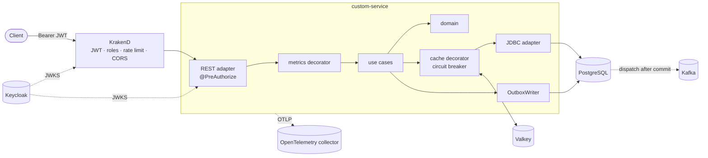

# Spring Boot Hexagonal Architecture

[](https://github.com/andresmontoyat/spring-boot-hexagonal-architecture/actions/workflows/validate.yml)


[](LICENSE)

A reference microservice that applies **hexagonal architecture (ports and adapters)** on **Java 21
and Spring Boot 4**, with the production concerns most samples leave out: transactional outbox,
caching with a circuit breaker, OAuth2 security behind an API gateway, OpenTelemetry, and a test
suite that runs every adapter against real infrastructure.

The domain is deliberately small — a `Custom` resource with a name — so the architecture is the
subject, not the business.

---

## Contents

- [Highlights](#highlights)
- [Architecture](#architecture)
- [Tech stack](#tech-stack)
- [Project structure](#project-structure)
- [Getting started](#getting-started)
- [Security](#security)
- [API](#api)
- [Events](#events)
- [Caching and resilience](#caching-and-resilience)
- [Scheduled jobs and concurrency](#scheduled-jobs-and-concurrency)
- [Observability](#observability)
- [Testing](#testing)
- [Configuration](#configuration)
- [Container image](#container-image)
- [Continuous integration](#continuous-integration)
- [Engineering guidelines](#engineering-guidelines)
- [How we arrived at this design](#how-we-arrived-at-this-design)
- [How the design evolves](#how-the-design-evolves)
- [Architecture decisions](#architecture-decisions)
- [Contributing](#contributing)
- [License](#license)

---

## Highlights

| Concern | Approach |
|---|---|
| Architecture | One Gradle module per layer; dependencies point inward; 10 ArchUnit rules enforce it at build time |
| Domain | Immutable aggregate with value objects and domain exceptions; no framework, no Lombok |
| Use cases | One inbound port per use case; transactions through a `TransactionPort`, never `@Transactional` |
| Cross-cutting | Metrics and cache as **decorators** chained in front of each port, ordered by `@Order` |
| Persistence | Spring Data JDBC + Liquibase on PostgreSQL, optimistic locking |
| Events | Transactional outbox → Kafka, published right after commit, keyed per aggregate |
| Cache | Valkey cache-aside, **fail-open**, guarded by a Resilience4j circuit breaker |
| Scheduled jobs | ShedLock lock per job and service, plus idempotent work per period |
| Security | Keycloak OAuth2; KrakenD validates at the edge **and** the service re-validates |
| Errors | RFC 9457 problem details with a stable machine-readable `code` |
| Observability | Use-case metrics, traces and logs exported over OTLP |
| Tests | TDD, fakes over mocks, Testcontainers for every adapter, Karate BDD acceptance suite |

---

## Architecture



### Layers

| Layer | Contains | May depend on |
|---|---|---|
| `domain` | `Custom` aggregate, `CustomId` / `CustomName` value objects, `CustomsReport` / `ReportPeriod`, domain exceptions | nothing (pure Java) |
| `application` | Use cases, inbound and outbound ports, commands, queries, integration events | `domain`, the framework-free outbox API |
| `infrastructure` | REST and scheduler entry points, JDBC / Valkey / metrics adapters | `application`, `domain`, frameworks |
| `bootstrap` | Spring Boot application, wiring, configuration | everything |

`bootstrap` is the only place that names a use case class. Every port bean is the head of a chain,
for example `CreateCustomPort` → metrics decorator → `CreateCustomUseCase`, and
`CustomRepositoryPort` → cache decorator → JDBC adapter. Adding a cross-cutting concern means adding
a decorator, not editing a use case.

### Request lifecycle — create

1. KrakenD checks the token (signature, issuer, audience, `platform-writer` role) and the rate limit.
2. The service re-validates the token; `@PreAuthorize("hasRole('WRITER')")` guards the endpoint.
3. The metrics decorator times the call and delegates to `CreateCustomUseCase`.
4. Inside one transaction the use case inserts the custom and writes `CustomCreated` to the outbox.
5. After commit the outbox SDK publishes the event to Kafka; the API answers `201` with
   `Location: customs/{id}`.

---

## Tech stack

| Area | Technology |
|---|---|
| Language / runtime | Java 21 (Temurin) |
| Framework | Spring Boot 4.0.8, Spring Framework 7, Spring Security 7 |
| Build | Gradle 9.7.1 (Kotlin DSL), Spotless (google-java-format), JaCoCo |
| Persistence | PostgreSQL 17, Spring Data JDBC, Liquibase |
| Messaging | Kafka, `io.codehunters:sdk-event-messaging` 9.1.0 (transactional outbox) |
| Cache | Valkey 8 (Redis protocol) via Spring Data Redis / Lettuce |
| Resilience | Resilience4j 2.4.0 |
| Security | Keycloak 26, OAuth2 resource server, KrakenD 2.13 |
| Observability | Micrometer, OpenTelemetry (OTLP), Grafana LGTM for local use |
| API docs | springdoc-openapi 3 |
| Testing | JUnit 5, AssertJ, Testcontainers 2, ArchUnit 1.5, Karate 1.5, Awaitility |

---

## Project structure

```text
.
├── domain/                                  # aggregate, value objects, domain exceptions
├── application/                             # use cases, ports, commands, events (+ test fixtures)
├── infrastructure/
│   ├── entry-points/
│   │   ├── rest-controller/                 # REST API, security, problem details
│   │   └── scheduler/                       # scheduled jobs under ShedLock
│   └── driven-adapters/
│       ├── jdbc-repository/                 # PostgreSQL adapter, transactions, Liquibase changelog
│       ├── valkey-cache/                    # cache decorator + circuit breaker
│       └── metrics-publisher/               # use-case metrics decorators
├── bootstrap/                               # Spring Boot app, wiring, application.yml, acceptance tests
├── docker/
│   ├── docker-compose.yaml                  # local stack
│   ├── keycloak/customs-realm.json          # realm as code
│   └── krakend/                             # gateway template + per-concern settings
├── docs/adr/                                # architecture decision records
├── Dockerfile
└── .github/workflows/validate.yml           # CI quality gate
```

---

## Getting started

### Prerequisites

- JDK 21 (Gradle downloads the toolchain if missing) and Docker.
- Read access to the Codehunters SDK on GitHub Packages, used by the outbox:

  ```bash
  export GH_PACKAGES_USERNAME=<github-user>
  export GH_PACKAGES_TOKEN=<classic token with read:packages>
  ```

### Build and test

```bash
./gradlew check           # tests, coverage gate, formatting and architecture rules
./gradlew spotlessApply   # fix formatting
```

The integration and acceptance tests start their own containers; nothing needs to be running.

### Run locally

```bash
./gradlew :bootstrap:bootRun
```

Spring Boot starts `docker/docker-compose.yaml` for you (or run
`docker compose -f docker/docker-compose.yaml up -d` yourself). If a port is already taken on your machine, override it,
for example `VALKEY_PORT=16379 SPRING_DATA_REDIS_PORT=16379 ./gradlew :bootstrap:bootRun`.

| URL | What |
|---|---|
| http://localhost:8000/api/v1/customs | API through KrakenD |
| http://localhost:8080/custom-service/api/v1/customs | API directly (a token is still required) |
| http://localhost:8080/custom-service/swagger-ui.html | OpenAPI UI (disabled in `prod`) |
| http://localhost:8081/actuator/health | Actuator, on its own port |
| http://localhost:8180 | Keycloak admin console (`admin` / `admin`) |
| http://localhost:3001 | Grafana: metrics, traces and logs |

### Try it

```bash
TOKEN=$(curl -s -X POST http://localhost:8180/realms/customs/protocol/openid-connect/token \
  -d grant_type=client_credentials \
  -d client_id=customs-writer-bot -d client_secret=local-writer-secret | jq -r .access_token)

curl -i -X POST http://localhost:8000/api/v1/customs \
  -H "Authorization: Bearer $TOKEN" -H 'Content-Type: application/json' \
  -d '{"name":"Demo"}'

curl -s http://localhost:8000/api/v1/customs -H "Authorization: Bearer $TOKEN" | jq
```

The secrets above are lab defaults from `docker/docker-compose.yaml`; override them in `docker/.env`.

---

## Security

Keycloak issues the tokens. **KrakenD** rejects missing or invalid tokens, wrong audiences and
missing roles before a request reaches the service, throttles each client and answers CORS
preflights. The **service** validates the same token again (signature via JWKS, issuer, audience
`customs-api`, expiry), so it stays safe even when reached directly. No identity header is trusted.
See [ADR 0004](docs/adr/0004-keycloak-resource-server-behind-krakend.md).

| Caller | Keycloak role | Can |
|---|---|---|
| `customs-writer-bot` (client credentials), user `alice` | `platform-writer` | read, create, rename, delete |
| `customs-reader-bot` (client credentials), user `bob` | `platform-reader` | read |
| `customs-web` | public client, Authorization Code + PKCE | browser login |

The realm lives in [`docker/keycloak/customs-realm.json`](docker/keycloak/customs-realm.json).
Client secrets and demo passwords come only from environment placeholders, never from the file.
`401` and `403` responses are problem documents with the codes `UNAUTHENTICATED` and
`ACCESS_DENIED`.

---

## API

| Method | Path | Role | Success |
|---|---|---|---|
| `GET` | `/api/v1/customs?page=0&size=20` | reader | `200` page envelope (`size` ≤ 100) |
| `GET` | `/api/v1/customs/{id}` | reader | `200` |
| `POST` | `/api/v1/customs` | writer | `201`, `Location: customs/{id}` |
| `PUT` | `/api/v1/customs/{id}` | writer | `200` |
| `DELETE` | `/api/v1/customs/{id}` | writer | `204` |

```json
{ "id": "7f1c2a52-3c1e-4b5e-9b7a-1f2d3c4b5a69", "name": "Demo", "version": 0 }
```

Errors follow [RFC 9457](https://www.rfc-editor.org/rfc/rfc9457) (`application/problem+json`).
Clients should branch on `code`:

| Status | `code` | When |
|---|---|---|
| 400 | `VALIDATION_FAILED` | Invalid body or parameters (`errors[]` lists the fields) |
| 401 | `UNAUTHENTICATED` | Missing or invalid token |
| 403 | `ACCESS_DENIED` | Token lacks the required role |
| 404 | `CUSTOM_NOT_FOUND` | Unknown id |
| 409 | `CUSTOM_CONCURRENT_MODIFICATION` | Optimistic lock conflict |
| 422 | `CUSTOM_INVALID_NAME` | Name breaks a domain rule |
| 500 | `INTERNAL_ERROR` | Unexpected failure; no internals leak |

---

## Events

Every write emits an integration event to the topic `customs.custom.events`, keyed by the custom
id so each custom's events stay in order.

| Event | Payload |
|---|---|
| `CustomCreated` | `{ id, name }` |
| `CustomRenamed` | `{ id, name, version }` |
| `CustomDeleted` | `{ id }` |

The event row is written in the **same transaction** as the business change. The outbox SDK
publishes it right after commit, with a polling fallback, exponential backoff and an idempotent
producer. Delivery is at-least-once: consumers deduplicate on the `outbox-message-id` header. Each
message also carries a `traceparent` header, so consumers continue the original request's trace.
See [ADR 0005](docs/adr/0005-transactional-outbox-with-codehunters-sdk-on-kafka.md).

---

## Caching and resilience

- **Cache-aside on reads by id**, stored in Valkey with a TTL. Renames and deletes evict the entry
  twice: immediately, and again after the transaction commits.
- **Fail-open:** if Valkey is down or returns garbage, the read goes to PostgreSQL and the error is
  counted.
- **Circuit breaker `valkey`:** once Valkey keeps failing, the breaker opens and requests skip
  Valkey instead of waiting for its timeout on every call.
- **Timeouts on every I/O:** Hikari 3 s, Valkey commands 200 ms, Kafka sends 5 s.
- **No breaker on the event publisher:** the outbox backoff already handles broker outages, and a
  breaker would burn retry attempts.

See [ADR 0006](docs/adr/0006-fail-open-valkey-cache-with-circuit-breaker.md).

---

## Scheduled jobs and concurrency

Every instance fires every `@Scheduled` trigger. The `customs-report` job stores, once a minute,
how many customs exist. It is small on purpose: it exists to show what goes wrong when several
instances run the same job, and how the service prevents it.

| Problem | What happens | Prevention |
|---|---|---|
| No coordination | Each instance runs the tick: N instances, N reports | ShedLock lock on the `shedlock` table: one instance runs, the rest log a skip |
| Lock expires mid-run | `lockAtMostFor` is shorter than the run, so a second instance takes the lock and both overlap | `lockAtMostFor` (2 m) well above the slowest run |
| Fast run, late instance | The lock is released at once; an instance that fires a moment later (jitter, slower pod) repeats the tick | `lockAtLeastFor` (30 s), kept below the 1-minute period |
| Clock skew between pods | Lock windows computed from each pod's clock | `usingDbTime`: windows are computed by PostgreSQL |
| Anything that still gets through | Two runs reach the same period | `INSERT … ON CONFLICT DO NOTHING` on the period's primary key; counted as `already_generated` |
| Overlap inside one instance | A slow run and the next fire on a multi-thread scheduler | A dedicated one-thread `jobTaskScheduler`, separate from the outbox SDK's scheduler |

The lock is taken programmatically in `CustomsReportJob`, in the same style as the outbox SDK, and
reuses the SDK's JDBC `LockProvider`. Each problem has a test in `CustomsReportJobConcurrencyIT`
that first reproduces it, then shows the fix:

```bash
./gradlew :scheduler:test --tests '*CustomsReportJobConcurrencyIT'
```

To watch it locally, start two instances against the same stack (the second one on other ports)
and follow the lock and the reports:

```sql
SELECT name, locked_by, locked_at, lock_until FROM shedlock;
SELECT * FROM customs_report ORDER BY period_start DESC LIMIT 5;
```

See [ADR 0007](docs/adr/0007-shedlock-for-scheduled-jobs-plus-idempotent-work.md).

---

## Observability

Metrics and traces are exported over OTLP. Locally they go to `grafana/otel-lgtm`, at
http://localhost:3001.

| Meter | Meaning |
|---|---|
| `usecase.operation` (+ `.calls`, `.errors`) | Latency and outcome per use case (`entity`, `operation` tags) |
| `cache.gets{result=hit\|miss}`, `cache.errors`, `cache.short_circuited` | Cache effectiveness and Valkey health |
| `outbox_pending_messages`, `outbox_oldest_pending_age_seconds`, `outbox_failed_messages` | Event backlog; alert when `failed > 0` |
| `outbox.publish` | Broker send latency and outcome |
| `customs.report.outcomes{outcome=generated\|already_generated}` | Report runs; any `already_generated` means two runs reached one period |
| `resilience4j_circuitbreaker_*` | Breaker state and calls |
| `http.server.requests` | HTTP latency histogram |
| `krakend_*` | Gateway latency (from KrakenD's own exporter) |

Logs are human-readable locally and JSON (logstash format) under the `prod` profile. Actuator runs
on its own port (8081), so it is never exposed through the public ingress.

---

## Testing

The tests were written first (TDD), and each layer is tested in isolation:

| Level | What | How |
|---|---|---|
| Domain | Invariants and behaviour | Plain JUnit, no mocks |
| Use cases | Orchestration, transaction boundary, event emission | In-memory **fakes** shared as Gradle test fixtures |
| REST | Status codes, validation, problem details, 401/403 | `@WebMvcTest` with forged JWTs |
| Adapters | SQL, optimistic locking, Valkey, circuit breaker | Testcontainers (PostgreSQL, Valkey) |
| Acceptance | End-to-end behaviour through the real HTTP stack | **Karate** BDD scenarios, real Keycloak tokens |
| Outbox | POST → PostgreSQL → Kafka record | Testcontainers Kafka |
| Gateway | Edge 401/403, routing, 429, CORS | The committed KrakenD config running in a container |
| Scheduled jobs | Duplicate and overlapping runs across instances, and their fixes | Simulated instances over a real `shedlock` table |
| Architecture | Layer rules | ArchUnit |
| Configuration | Production YAML binds to real types | Binder test |

`./gradlew check` runs **123 tests** and fails if any module's line coverage drops below 80%.

---

## Configuration

There is a single [`application.yml`](bootstrap/src/main/resources/application.yml). Every value is
`${ENV_VAR:default}`, and the variable name follows the property path
(`spring.data.redis.port` → `SPRING_DATA_REDIS_PORT`).

| Group | Purpose |
|---|---|
| `spring.datasource.*`, `spring.liquibase.*` | PostgreSQL and migrations |
| `spring.data.redis.*`, `cache.custom.*` | Valkey connection, cache TTL and key prefix |
| `spring.kafka.*`, `codehunters.outbox.*` | Broker connection and outbox tuning (durations) |
| `spring.security.oauth2.resourceserver.jwt.*`, `security.keycloak.*` | Token validation and role mapping |
| `resilience4j.circuitbreaker.instances.valkey.*` | Breaker thresholds |
| `jobs.customs-report.*` | Cron (`-` disables it), lock name and lock windows |
| `management.*` | Actuator, OTLP endpoints, tracing sampling |

Profiles: the default profile is for local runs; `prod` switches to JSON logs and disables Swagger.

---

## Container image

```bash
./gradlew :bootstrap:bootJar   # the Dockerfile packages this jar; it does not compile
docker build -t custom-service .
```

The image is built in two stages. The first splits the Spring Boot jar into layers, so dependency
layers stay cached across releases. The second runs on a pinned Temurin 21 JRE (Alpine) with these
defaults:

- non-root UID `10001`, with application files root-owned and read-only to that user;
- heap sized from the container memory limit, and the JVM exits on out-of-memory;
- `prod` profile;
- liveness `HEALTHCHECK` on the actuator port.

Credentials for GitHub Packages never enter the image build.

---

## Continuous integration

[`validate.yml`](.github/workflows/validate.yml) calls the shared
[`java-pr-pipeline`](https://github.com/Codehunters-IO/ci-templates). It runs `./gradlew check`,
TruffleHog secret scanning and dependency review on branches and pull requests. The repository
needs two secrets: `GH_PACKAGES_USERNAME` and `GH_PACKAGES_TOKEN`.

---

## Engineering guidelines

This service is the reference implementation of a set of written engineering standards maintained
alongside it. They are short, binding rules, each with a reason and a pre-merge checklist. This
repository is where they are proven in running code. These are the ones it applies:

| Guideline | What it mandates | Where you see it here |
|---|---|---|
| Hexagonal architecture | Dependencies point inward; every use case implements an inbound port; transactions through a port; cross-cutting concerns as decorators | Module layout, `TransactionPort`, `PortChain`, 10 ArchUnit rules |
| Java code style | Records for data, immutable aggregates with private constructors and factories, static mappers, `Optional` over `null`, no field injection | `Custom`, `CustomName`, `*Mapper` classes |
| Testing | TDD (red → green → refactor); domain tests without mocks; fakes over mocks; Testcontainers for adapters; Karate for entry points | Test suites per layer, shared test fixtures |
| Gradle | Kotlin DSL, Java 21 toolchain, BOM-managed versions, Spotless, JaCoCo ≥ 80% wired into `check` | `build.gradle.kts`, `gradle.properties` |
| `application.yml` | One file, profile documents, every value `${VAR:default}` with derivable names, actuator on its own port, comments explain *why* | `bootstrap/src/main/resources/application.yml` |
| API design | Versioned paths, status-code matrix, RFC 9457 errors with a stable `code`, bounded pagination | `CustomController`, `GlobalExceptionHandler` |
| Messaging | Outbox only (no dual writes), events keyed per aggregate, one writer per key, idempotent consumers | `CustomEventOutbox`, ArchUnit outbox rules |
| Resilience | Timeout on every I/O, resilience only in infrastructure, retry only idempotent calls, no stacked retries, fail-open vs fail-closed decided explicitly | `ResilientValkey`, explicit timeouts, ADR 0006 |
| Security / identity | One topology per platform recorded as an ADR, roles mapped consistently, `@PreAuthorize` on inbound adapters only, mandatory negative tests | `SecurityConfig`, realm as code, 401/403 tests |
| API gateway | Flexible Configuration split per concern, env-overridable hosts, edge JWT, rate limits, CORS | `docker/krakend` |
| Observability | Metrics through decorators, low-cardinality tags, OTLP export | `metrics-publisher`, `management.*` |
| ADRs | Architecturally significant changes recorded (MADR) before merge; accepted ADRs are never edited | `docs/adr/` |
| Git workflow | Conventional Commits, atomic commits, signed commits, branch per change | Repository history |

## How we arrived at this design

The repository started as a Java 8 / Spring Boot 2.3 template. Its folders were named after
hexagonal layers, but the architecture was not enforced. We rebuilt it one layer at a time, starting
from the domain and working outwards, writing the tests first at each step.

1. **Audit of the template.** Framework annotations sat in the domain and entities were mutable.
   JPA generated the schema, Springfox no longer worked, and the build resolved from the retired
   JCenter. It also had real bugs: validation was inverted (only invalid input was saved), `isNew()`
   was inverted, and an unknown id returned a 500 instead of a 404.
2. **Baseline first.** Moved to Java 21, Spring Boot 4 and Gradle 9 before any feature work, with
   quality gates (coverage, formatting, `-Werror`) in place from the first commit
   ([ADR 0002](docs/adr/0002-java-21-spring-boot-4-gradle-9.md)).
3. **Inside out, test first.** Domain, then use cases with fakes, then each adapter against its real
   technology, then the wiring. ArchUnit landed with the wiring, so the boundaries were enforced
   before features were added on top.
4. **Cross-cutting concerns as decorators.** Metrics and cache were added without touching a single
   use case. That validated the port-and-decorator design in practice
   ([ADR 0001](docs/adr/0001-hexagonal-modules-and-decorator-chain.md)).
5. **Events, security, resilience.** The outbox, Keycloak behind KrakenD, and the circuit breaker
   came in that order. Each choice was recorded as an ADR
   ([0004](docs/adr/0004-keycloak-resource-server-behind-krakend.md),
   [0005](docs/adr/0005-transactional-outbox-with-codehunters-sdk-on-kafka.md),
   [0006](docs/adr/0006-fail-open-valkey-cache-with-circuit-breaker.md)).
6. **Delivery.** Shared CI pipeline, a hardened container image, and a full local stack.

Applying the guidelines to real code fed back into the guidelines themselves:

- **The messaging guideline had drifted from the outbox SDK it describes.** It taught a pre-9.0 port
  (`OutboxRepositoryPort`), a configuration prefix the SDK silently ignores, and an envelope field
  that no longer exists. We checked the guideline against the SDK's sources and READMEs, rewrote
  it, and added regression checks so the drift cannot come back unnoticed.
- **There was no resilience guideline.** It was written while building the cache's circuit breaker.
  One rule came straight out of this work: no breaker on the outbox publisher, because it would
  burn retry attempts.
- **Two rules contradicted each other.** Metrics decorators wrap inbound ports, so they see
  commands, but a general rule forbade commands in driven adapters. The ArchUnit rule now names the
  exception and the reason, and a second rule keeps those decorators away from persistence.
- **Running the real stack exposed a gap no test covered.** The test configuration shadows the
  production `application.yml`, so a wrongly typed value (`connection-timeout: 3s`) only failed at
  startup. A binding test now loads the production file on every build.
- **Choosing the security topology was a guideline decision, not a matter of taste.** Trusting
  identity headers from the gateway needs a guaranteed network boundary. A public template run with
  Docker Compose cannot provide one, so the service validates tokens itself.

## How the design evolves

Every change follows the same loop: **guideline → ADR → enforcement → feedback.**

- **Guidelines** state the rule and its reason.
- **ADRs** record how this service applies a rule, or why it deviates. They are append-only: a
  change of mind gets a new ADR that supersedes the old one.
- **Enforcement** turns rules into failing builds: ArchUnit for structure, the coverage gate,
  Spotless, `-Werror`, configuration-binding tests and acceptance tests. A rule that has been broken
  twice gets an automated check instead of a reworded paragraph.
- **Feedback**: when the code and a guideline disagree, the gap is fixed at its source, in the
  guideline, the SDK or the test, and recorded in the guidelines' audit log.

Next on the roadmap:

| Item | Why |
|---|---|
| `CurrentUserPort` and audit fields | Identity reaches use cases through a port, never through the security context |
| `Idempotency-Key` on `POST`, `ETag` / `If-Match` on `PUT` | Safe client retries and client-side optimistic concurrency |
| A sample idempotent consumer | Shows deduplication on `outbox-message-id` end to end |
| Toxiproxy tests for Valkey and the broker | Prove the timeout budget and breaker behaviour under latency, not just under total outage |
| Main-branch pipeline (image build, scan, release) | Same shared templates as validation |
| Kubernetes manifests with a NetworkPolicy | Prerequisite for ever switching to gateway-first identity headers |
| Consumer-driven contract tests for events | Catch schema drift before deploy |

## Architecture decisions

| ADR | Decision |
|---|---|
| [0001](docs/adr/0001-hexagonal-modules-and-decorator-chain.md) | Hexagonal Gradle modules with a decorator chain per port |
| [0002](docs/adr/0002-java-21-spring-boot-4-gradle-9.md) | Java 21, Spring Boot 4 and Gradle 9 |
| [0003](docs/adr/0003-spring-data-jdbc-and-liquibase.md) | Spring Data JDBC with Liquibase instead of JPA |
| [0004](docs/adr/0004-keycloak-resource-server-behind-krakend.md) | Keycloak tokens validated at the edge and by the service |
| [0005](docs/adr/0005-transactional-outbox-with-codehunters-sdk-on-kafka.md) | Transactional outbox on Kafka through the event-messaging SDK |
| [0006](docs/adr/0006-fail-open-valkey-cache-with-circuit-breaker.md) | Fail-open Valkey cache behind a circuit breaker |
| [0007](docs/adr/0007-shedlock-for-scheduled-jobs-plus-idempotent-work.md) | Scheduled jobs under ShedLock, with idempotent work per period |

---

## Contributing

- Branches: `feature/*`, `fix/*`, `refactor/*`. Commits follow
  [Conventional Commits](https://www.conventionalcommits.org/).
- Write the test first. `./gradlew check` must pass: formatting, coverage of 80% or more, and the
  architecture rules.
- Record architecturally significant changes as a new ADR in `docs/adr/`.

See [CONTRIBUTING.md](CONTRIBUTING.md) and [CHANGELOG.md](CHANGELOG.md).

## License

[GNU General Public License v3.0](LICENSE)
